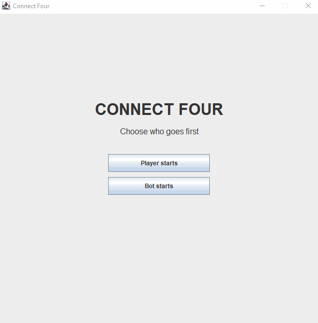

# Connect Four

A desktop Connect Four game built in Java Swing, featuring an AI opponent powered by the **[MiniMax](https://en.wikipedia.org/wiki/Minimax)** algorithm with **[Alpha-Beta pruning](https://en.wikipedia.org/wiki/Alpha–beta_pruning)**.
Originally designed as a game against an AI bot, this project can also be used as a smart assistant to help strategize and win matches against other players.

<p align="center">
  
</p>

---

## Features
- Interactive graphical user interface built with Java Swing.
- Intelligent AI opponent using the MiniMax algorithm (Depth 9) with Alpha-Beta pruning.
- Flexible configuration to let either the player or the bot go first.

---

> [!NOTE]
> The application can be run locally alongside any online or physical game to calculate the optimal moves as a helper bot.

---

## Requirements
- Java Development Kit (JDK) 8 or higher.
- Compatible Java compiler or IDE (IntelliJ IDEA, Eclipse, NetBeans).

## Installation & Run

1. **Clone the repository:**
   ```bash
   git clone https://github.com/sma1lo/ConnectFour.git && cd ConnectFour
   ```

2. **Build the executable JAR file:**
   **Linux / macOS:** 
    ```bash
    chmod +x gradlew && ./gradlew build
    ```
   **Windows:** 
    ```bash
    .\gradlew.bat build
   ```

3. **Run the simulation:**
   ```bash
   java -jar build/libs/ConnectFour-1.0-SNAPSHOT.jar
   ```
